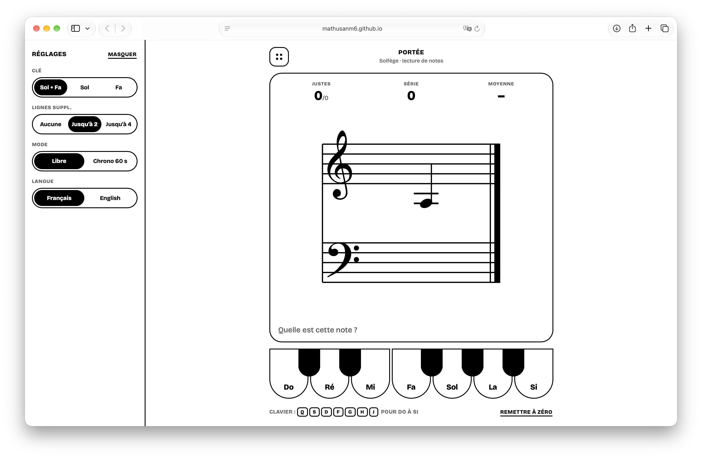

# Portée

A sight-reading trainer: a note appears on the staff, you name it. French (Do Ré Mi…) and English (C D E…).

**Live:** https://mathusanm6.github.io/Sight-Reading-Practice/



## Features

- **Clefs:** treble, bass, or both at once on a grand staff. The gap between the staves grows with the ledger-line limit, so notes can pass middle C on either staff.
- **Ledger lines:** none, up to 2, or up to 4.
- **Modes:** *Free* (running average reaction time) or *Timed* (60 s, with a best score saved per clef/ledger combination).
- **Language:** French or English. It switches all text and the note names, and keeps the running session.
- **Answering:** click the piano keys, or use the keyboard.
- **Settings sidebar:** on the left, collapsible, remembered between visits. On narrow screens it is a drawer. The exercise always fits the viewport height.
- **Theme:** monochrome, follows the system light/dark setting.

### Keyboard

| | Do · Ré · Mi · Fa · Sol · La · Si |
| --- | --- |
| French | `Q` `S` `D` `F` `G` `H` `J` (AZERTY home row) |
| English | `C` `D` `E` `F` `G` `A` `B` |
| Either | `1`–`7` |

`Enter` / `Space` starts a timed session or skips the wait after an answer.

## Development

Requires Node 22+.

```
npm install
npm run dev          # http://localhost:3000
npm test             # unit tests (vitest)
npm run lint
npm run typecheck
npm run build        # static export to ./out
```

To preview the production build: `npx serve out`. (`npm start` does not apply to a static export.)

## Deploy

`.github/workflows/deploy.yml` runs on every push to `main`: lint, typecheck, tests, build, then publish to GitHub Pages. A failing check blocks the deploy.

- One-time setup: repo **Settings → Pages → Source: GitHub Actions**.
- The app is a static export (`output: "export"` in `next.config.ts`). The workflow sets `BASE_PATH` from the repo name (`/<repo>`, or empty for `<user>.github.io` repos). Locally it is unset.

## Project layout

| Path | Role |
| --- | --- |
| `src/domain/` | Pure logic, no React or DOM: notes, clefs, staff geometry, settings, timing, key mapping. Unit-tested. |
| `src/session/` | The practice session: a pure reducer (`reducer.ts`), `useSession` (timers + persistence), `useCountdown`. |
| `src/i18n/` | All UI text (`messages.ts`: French and English, including note names) and the `useMessages` hook. |
| `src/lib/` | Browser glue: guarded `localStorage` access, class-name helper. |
| `src/hooks/` | Reusable hooks (keyboard shortcuts, sidebar state). |
| `src/components/` | Presentational React components, each with a co-located CSS module. |
| `src/styles/tokens.css` | Colour and typography tokens, light and dark. |

Data flows one way: `useSession` owns the state, `PracticeApp` passes it down, and components render it and call back.
Randomness and clocks are passed into the reducer as action fields, so it stays pure and easy to test.

### Adding a language

Add one object satisfying `Messages` in `src/i18n/messages.ts`, add its code to `LANGUAGES` in `src/domain/settings.ts`, and give it shortcut letters in `src/domain/keyboard.ts`. TypeScript flags anything missing.
